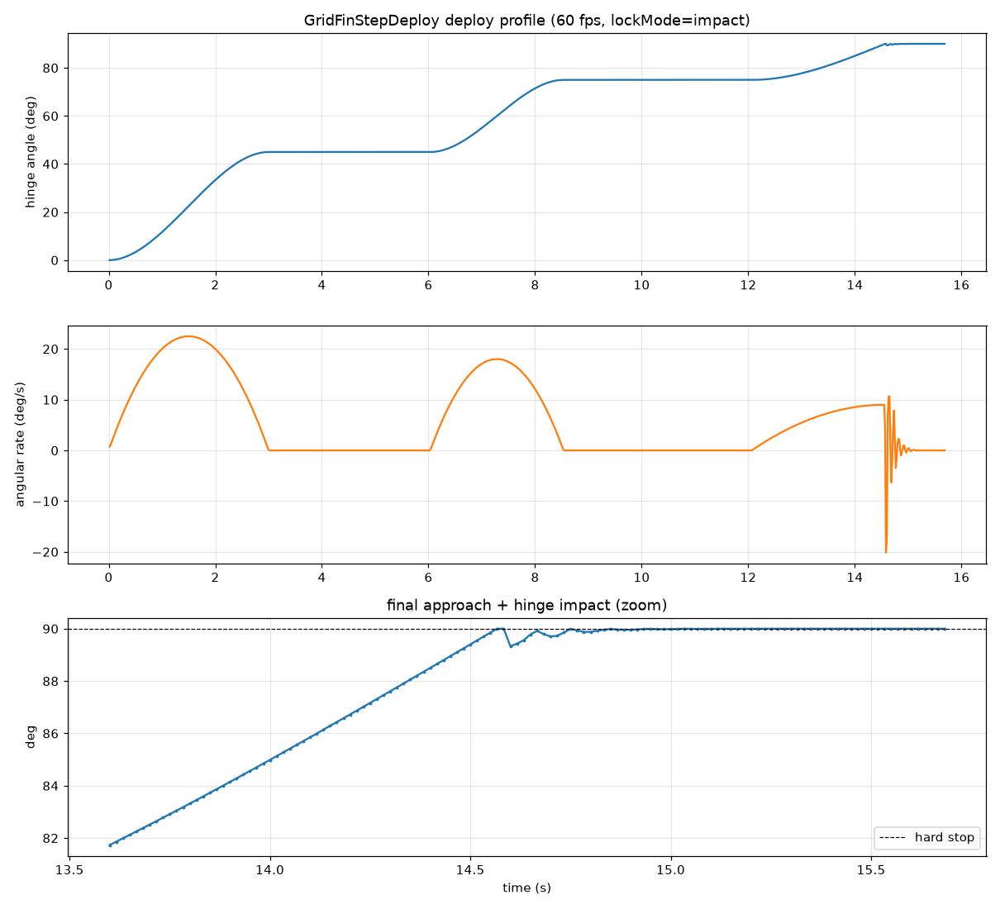

# GridFinStepDeploy

Falcon 9-style **stepped grid fin deploy** for **Kerbal Space Program 1.12.x**. The KRE titanium grid fins (Grid Fin S/M/L Titanium) deploy in steps instead of one smooth swing, then lock with a small hinge impact. There's an in-game tweak window for editing the profile.

Default profile, timed from a CRS-35 webcast: 0→45° over 3 s, hold 3 s; →75° over 2.5 s, hold 3.5 s; →90° over 2.5 s; then the hinge-impact lock.

## Features
- Stepped deploy with editable steps (target angle, move time, hold time; add/remove steps)
- Hinge-impact lock with rebound, damping and shiver (or bounce / none)
- Toolbar tweak window in flight, VAB and SPH: **Apply + save**, **Preview deploy/retract**, **Reset to CRS-35 defaults**
- Retract mode and time settings

## Requirements
- KSP 1.12.x
- [ModuleManager](https://github.com/sarbian/ModuleManager)
- [ToolbarController](https://github.com/linuxgurugamer/ToolbarControl)
- [ClickThroughBlocker](https://github.com/linuxgurugamer/ClickThroughBlocker)
- The KRE titanium grid fin parts (Grid Fin S/M/L Titanium)

## Tested with
Only tested with the KRE titanium grid fins on Tundra Exploration's Falcon 9. Other grid fin parts aren't patched and other setups are untested, so they may not work.

## Building
Targets .NET Framework 4.8 (`dotnet build -c Release` in `src/`). Point the references in the `.csproj` at your own Assembly-CSharp, UnityEngine*, ToolbarControl and ClickThroughBlocker DLLs (not distributed).

## License
MIT (see `LICENSE`).
